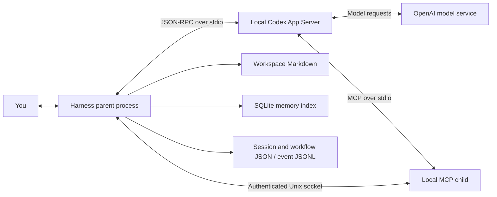

# Architecture

[Documentation](README.md) · [Project home](../README.md)

## What an agent harness does

A harness is the application around an agent. It accepts a task, supplies context, tracks work, provides tools, asks for decisions, and decides when to stop. This project has two exercises:

- **Offline toy:** a scripted model chooses actions, receives tool observations, and stops after completion or a fixed limit. This makes the inner loop easy to inspect.
- **Live harness:** Codex owns the real model/tool loop. Our TypeScript process builds the interface, context, policies, and workflow around it.

## Process map



The parent owns memory synchronization and the five workspace tools. The MCP child forwards those requests. Legacy journal reads run in that child against a fixed file; journal append asks the parent for approval before the child writes. Codex can also have its own tools and inherited configuration.

## Follow one task

1. The CLI selects a workspace, opens local stores, connects to Codex, and creates or resumes a thread.
2. You submit a message. The parent synchronizes Markdown memory and selects relevant reference material within a character budget.
3. The client sends `turn/start`. An acknowledgment identifies the turn; it does not mean the work is finished.
4. Streamed notifications update the conversation and activity cards. Approval requests pause for a displayed decision. Application tool calls are validated at the parent boundary.
5. A terminal turn status completes, fails, or interrupts the task. The parent clears active state, cancels associated operations, and persists the result.

Only one turn is active at a time. Unknown outcomes stop automatic progression: an interrupted connection is not proof that no side effect happened.

## Three stores with different jobs

| Store | Owns |
| --- | --- |
| Codex history | The real conversation that can be resumed |
| Harness JSON/JSONL | Local session indexes, workflow state, and bounded event inspection |
| Workspace Markdown + SQLite | Explicitly saved durable knowledge and its rebuildable search index |

A local session points to a Codex thread; the IDs differ. Replaying an event file renders observations without resubmitting tasks. Workspace to-dos are separate revisioned JSON and do not automatically become memory.

## Source map

```text
src/cli.ts             Startup, command routing, and shutdown
src/tui/               Input decoding, editing, screen state, rendering
src/transport.ts       Child-process I/O and message framing
src/rpc.ts             Requests, responses, and notifications
src/codex.ts           Typed App Server boundary
src/session.ts         Active turn, approvals, resume, and cancellation
src/tools/             MCP registry, adapters, and authenticated bridge
src/workspace-tools/   Search, Git, npm checks, and workspace to-dos
src/memory/            Markdown and SQLite synchronization/recall
src/store.ts           JSON records and bounded JSONL events
src/workflow.ts        Bounded implement/check/repair/review exercise
```

## Read the code in learning order

1. [Toy loop](../examples/toy-loop.ts): actions, tool dispatch, observations, and stopping.
2. [Transport](../src/transport.ts) and [RPC](../src/rpc.ts): JSON framing and request correlation.
3. [Codex client](../src/codex.ts): the small typed boundary with the real runtime.
4. [Session](../src/session.ts) and [events](../src/events.ts): state, completion, and rendering.
5. [Store](../src/store.ts): atomic records and append-only event history.
6. [Approvals](../src/approvals.ts): decisions, IDs, cancellation, and EOF handling.
7. [Tool registry](../src/tools/registry.ts), [journal](../src/tools/journal.ts), and [MCP server](../src/tools/server.ts): application-owned tool execution.
   [Workspace service](../src/workspace-tools/service.ts), [task store](../src/workspace-tools/todos.ts), and [process runner](../src/workspace-tools/process.ts) implement the five local tools behind the forwarding adapter.
8. [Memory files](../src/memory/files.ts), [service](../src/memory/service.ts), and [context](../src/context.ts): Markdown ownership, disposable search, and bounded recall.
9. [Workflow](../src/workflow.ts): deterministic transitions around real agent turns.
10. [CLI](../src/cli.ts): terminal input, live execution, controls, and shutdown.

Tests cover protocol chunking, acknowledgment races, disconnects, stale approvals, write denial, symlink rejection, MCP discovery/calls, subprocess cleanup, persistence, playback, and bounded workflow behavior. Memory checks exercise restart/rebuild, external edits, workspace isolation, punctuation-safe search, recall budgets, index failure recovery, parent-owned MCP operations, and fresh-conversation context. CLI tests use a clearly synthetic runtime and do not invoke a model. Socket/process tests require a local environment that permits Unix sockets and subprocesses.

Workspace-tool tests additionally cover ignored paths, Git subtree filtering and unchanged index bytes, npm hook execution and changed definitions, task limits/revisions/atomicity, MCP cancellation, invalid credentials, missing executables, offline command execution, and direct-terminal interruption of a running check.

This is a learning implementation: sequential execution, local files with a SQLite search index, and a visible protocol boundary. Follow the milestone experiments in the plan to understand the choices and their limits.
