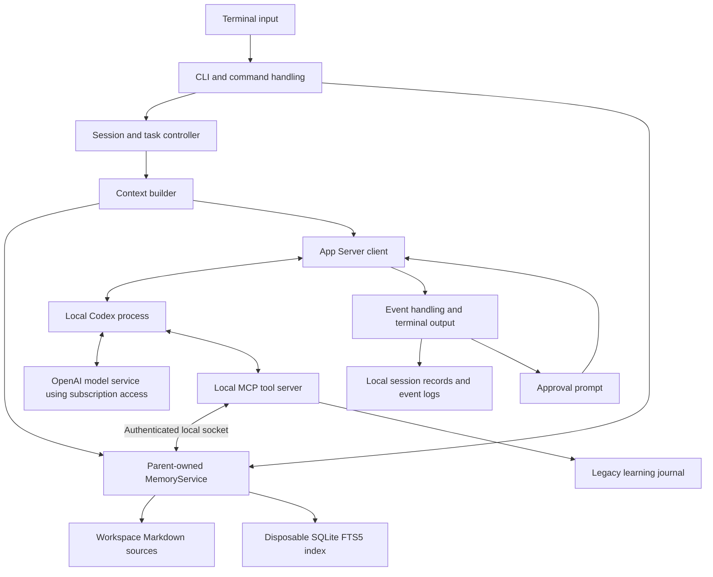

# Build a local agent harness to learn how it works

Created: November 18, 2026  
Status: implemented as a local learning harness. See [README](../README.md) for commands and [development notes](../notes/development.md) for completed checks and remaining live experiments.

## 1. Purpose and constraints

Build a small terminal application that drives a local Codex runtime. The purpose is to understand agent harnesses by implementing their surrounding machinery, observing execution, and deliberately breaking and repairing individual parts.

Use the existing ChatGPT subscription for eligible local Codex access. The project must work without an OpenAI API key or purchased API credits. Subscription limits still apply, and model inference still requires an internet connection. Local process communication and file storage do not make the model itself local. Codex documents ChatGPT subscription sign-in separately from API billing in its [authentication guide](https://learn.chatgpt.com/docs/auth).

Keep the implementation small:

- TypeScript and Node.js 22.17 or newer.
- One terminal interface and one local Codex child process.
- One active conversation and one active turn at a time.
- JSON for small records, JSONL for event history, Markdown for durable notes, and a disposable SQLite FTS5 memory index.
- A few application-owned tools, introduced one at a time.
- No database service, Redis, queue service, web server, deployment, or agent framework. SQLite runs inside Node without a separate service.

Prefer code that is easy to inspect over abstractions intended for hypothetical future requirements. Add a module when an actual milestone needs it.

## 2. What we are learning and what we are borrowing

There are two connected exercises:

1. Build a tiny offline agent loop with a scripted model substitute. This exposes tool dispatch, observations, stopping conditions, and policy decisions without spending subscription usage.
2. Build a useful local harness around Codex. This exercises process management, protocol communication, streaming, conversation state, permissions, tools, memory, and task orchestration with a real coding agent.

The scripted model is explicitly a teaching device. It does not reason or demonstrate model quality.

Codex supplies the real inner agent loop and its execution facilities. Our application supplies the user experience, application state, tool implementations, context selection, and outer workflow. OpenAI describes this ownership split in [Codex as a platform](https://developers.openai.com/blog/codex-as-a-platform).

| Concept | What we implement | What we observe through Codex |
| --- | --- | --- |
| Agent loop | Offline toy loop and later an outer task workflow | Actual model/tool iteration inside a turn |
| Context | Task instructions and selected project notes | Effects of conversation continuity and supplied context |
| Tools | Schemas, validation, handlers, results | When the agent chooses to invoke a tool |
| Permissions | Terminal decisions and application tool policy | Requests from the runtime and sandbox outcomes |
| State | Session index, task records, event log | Codex thread and turn identifiers |
| Recovery | Disconnect handling and explicit resume | Persisted conversation behavior |
| Verification | Local checks against actual files | Agent explanations and reported outcomes |

By the end, be able to follow a task from terminal input to final artifact and explain which component made each decision. Do not equate access to execution events with access to private model reasoning.

## 3. Integration choice and initial environment

Use Codex App Server over standard input/output. Write a thin client directly rather than hiding the protocol behind the Codex SDK initially. The SDK can be a later comparison exercise.

App Server exposes threads, turns, streamed items, approval requests, and interruption through a bidirectional protocol. Its standard input/output transport uses newline-delimited JSON; the wire format omits the usual JSON-RPC `jsonrpc` member. See the [official App Server documentation](https://learn.chatgpt.com/docs/app-server).

Observed in this workspace when preparing the plan:

| Component | Observation |
| --- | --- |
| Workspace | No application files or existing plan structure |
| Node.js | `v22.17.0` |
| npm | `10.9.2` |
| Codex CLI | `0.162.0-alpha.17.2` |
| App Server | Available; supports stdio and TypeScript protocol generation |

The available CLI comes from an editor extension and is an alpha build. Treat its executable path as environment-specific. Record the actual executable/version during implementation and allow a `CODEX_BIN` application option. A standalone installation is an option if the extension-provided executable changes or cannot run independently.

Generate protocol types from the executable being used instead of copying a large set of types from online examples. The following command was verified against the installed executable while planning:

```bash
codex app-server generate-ts --out ./generated/codex
```

During planning, generation was performed only in a temporary directory. Implementation now generates local bindings under the ignored `generated/codex/` directory. Regenerate them when deliberately changing runtime versions.

Initial dependencies: TypeScript, Node type definitions, and a TypeScript runner such as `tsx`. Use Node built-ins for subprocesses, line handling, file operations, and tests. Add an MCP server library only at the tool milestone; choose and verify its current official API then. Do not introduce a dependency injection framework or general plugin system.

## 4. Intended architecture



Use one process for the terminal application and a child process for Codex. Add a second child process for the MCP server only when needed. The local MCP process is owned by the application project but can be started by Codex from configuration.

Keep model requests inside Codex. Do not extract subscription tokens or implement a substitute authentication client.

## 5. Final project layout, grown incrementally

This is a destination, not a scaffolding task for the first session.

```text
plans/
  learning-harness-plan.md
src/
  cli.ts                 # terminal entry point and commands
  transport.ts           # child process and message framing
  rpc.ts                 # correlation of requests and responses
  codex.ts               # small typed integration boundary
  session.ts             # conversation and active-turn state
  events.ts              # event normalization and rendering
  approvals.ts           # operator decisions for runtime requests
  store.ts               # JSON records and JSONL appends
  context.ts             # compose task with selected reference data
  memory/
    files.ts             # ordinary Markdown, validation, and atomic saves
    service.ts           # parent-owned SQLite index, synchronization, recall
    commands.ts          # explicit terminal memory operations
    agent.ts             # approval before agent saves, trusted provenance
    types.ts             # memory records and tool schemas
  tools/
    registry.ts          # application tool contracts and dispatch
    journal.ts           # read/search/add note handlers
    memory.ts            # MCP adapter to parent-owned memory operations
    server.ts            # MCP adapter
  workflow.ts            # bounded implementation/check/review flow
examples/
  toy-loop.ts            # offline scripted model exercise
fixtures/
  sample-project/        # disposable code and checks
  protocol/              # synthetic or sanitized message fixtures
generated/
  codex/                 # bindings for the chosen Codex version
notes/
  learning-journal.md
  project-decisions.md
.harness/                # ignored runtime data
  sessions/
  events/
  tasks/
  memory.sqlite          # rebuildable search index
<selected-workspace>/memory/
  facts/
  decisions/
  preferences/
  lessons/
  summaries/
```

Keep credentials out of every application record. Ignore `.harness/`, temporary fixtures, dependencies, and build output in version control. Intentionally authored notes can be committed after review. Decide whether to commit generated protocol files when they first become necessary, and record the generating version either way.

## 6. Milestone 0 — Establish a working baseline

**Question:** Can the local runtime be reached using the existing subscription?

Build and investigate:

1. Create the minimal TypeScript package and commands for development and type checking.
2. Record the runtime path and version in a small development note.
3. Check `codex login status`. If needed, use the official `codex login` flow outside the harness.
4. Confirm a tiny interactive Codex request works with ChatGPT sign-in. Do not configure an API-key fallback.
5. Inspect App Server help and generate matching protocol bindings.
6. Create a disposable sample project with a small deterministic check, such as a function with a failing assertion.

Authentication check commands come from the [official authentication documentation](https://learn.chatgpt.com/docs/auth). Do not print token files or environment secrets to diagnose sign-in.

**Experiment:** Distinguish an absent executable, missing sign-in, a network problem, and exhausted subscription usage. Each should lead to a different explanation.

**Done when:** The executable and authentication path are known, TypeScript runs, and the fixture check produces a predictable result.

**Learning note:** Explain why spawning a local process does not mean running a model on the local machine.

## 7. Milestone 1 — Build an offline inner loop

**Question:** What turns a model response into an agent that can act?

Write `examples/toy-loop.ts` with a scripted model function and one tool. Use an in-memory note store first so the exercise stays tiny.

```text
task + accumulated messages
          ↓
scripted next action
          ↓
final answer? ── yes → finish
          │
          no
          ↓
validate tool call → check permission → execute tool
          ↓
append observation → repeat, up to a fixed limit
```

Represent actions as a discriminated union: either a final answer or a tool request with a name and arguments. The scripted model first asks to read a note, then produces an answer based on the observation. Keep the model substitute visibly separate from tool dispatch.

**Experiments:** Return an unknown tool, invalid arguments, a denied action, a tool error, and repeated calls that never finish. Give each a deliberate handling path and enforce a maximum of five iterations.

**Done when:** A task completes through a tool observation, and a nonterminating script stops at the limit. This exercise must run without network access or a subscription request.

**Learning note:** Identify the difference between a tool description, a selected tool call, execution, and an observation. Explain why tool output must be appended before the next model decision.

## 8. Milestone 2 — Reach Codex through a transparent transport

**Question:** How does our program communicate with the real agent runtime?

Build `transport.ts`, `rpc.ts`, and a small one-shot entry point:

1. Spawn the configured Codex executable in App Server stdio mode, without a shell wrapper.
2. Consume stdout as a stream of complete JSON lines. Keep stderr separate as diagnostics.
3. Add increasing request IDs and a pending-request map.
4. Separate inbound responses, notifications, and server-initiated requests. Detect the presence of an ID instead of relying on truthiness.
5. Complete initialization before sending ordinary requests.
6. Reject outstanding requests when the process exits or the stream becomes unusable.
7. Apply a configurable timeout to ordinary request acknowledgments, independently from how long a task may run.

Use local generated types to shape the initial message exchange. Relevant locally verified method names include `initialize`, `thread/start`, and `turn/start`.

**Experiments:** Use a fake child process or stream fixture that splits one message across chunks, places several messages in one chunk, returns responses in a different order, and exits with a pending request.

**Done when:** One short task can be sent and its events printed. An unexpected child exit fails promptly instead of leaving an unresolved promise.

**Learning note:** Explain why the reply acknowledging task submission is different from completion of the agent's work.

## 9. Milestone 3 — Render a turn and understand its lifecycle

**Question:** What happens between submitting a prompt and receiving a result?

Introduce a session controller and a readable event renderer. Begin with application states such as `idle`, `running`, `waitingForApproval`, `interrupting`, and `disconnected`. These are application states, not copies of every Codex status.

Implement:

- Start one conversation and accept sequential user prompts.
- Track the current thread, turn, and item IDs separately.
- Render incremental assistant text without printing it twice at completion.
- Show concise tool, command, and file activity as separate output.
- Wait for the terminal turn event and inspect its status.
- Keep unfamiliar notifications visible in debug output without crashing ordinary rendering.
- Handle server requests even before the approval UI exists: give a supported rejection or stop with a clear unsupported-request error. Never silently leave the runtime waiting forever.

Locally generated bindings include `turn/started`, `item/started`, `item/agentMessage/delta`, `item/completed`, and `turn/completed`. Their turn-status union includes `inProgress`, `completed`, `interrupted`, and `failed`.

**Experiment:** Ask the agent to inspect the fixture and explain the failure without modifying files. Annotate a trace with request acknowledgment, item activity, text updates, and terminal status.

**Done when:** Two consecutive prompts share one conversation, active-turn state clears correctly, and another turn cannot accidentally start while one is running.

**Learning note:** Explain why a completed message or successful tool call does not establish that the entire task is finished.

## 10. Milestone 4 — Add a usable terminal interface

**Question:** How does a person remain in control during execution?

Use Node terminal primitives before adopting a terminal UI library. Introduce commands incrementally:

| Command | Intended application behavior |
| --- | --- |
| `/new` | Begin a fresh conversation when idle |
| `/status` | Show session, turn, workspace, runtime version, and state |
| `/stop` | Request interruption of the active turn |
| `/exit` | Shut down child processes and exit cleanly |
| `/help` | Show available commands |

Keep terminal commands responsive while a turn runs. Distinguish ordinary prompt input from approval input. For the first version, refuse ordinary additional prompts while busy; queuing and steering can wait.

Define Ctrl+C behavior: interrupt active work first, then allow an explicit exit. A second Ctrl+C during shutdown may terminate the process after a brief grace period.

**Experiment:** Interrupt a deliberately slow fixture operation. Observe any files already changed; interruption does not imply rollback.

**Done when:** The terminal remains responsive, stop requests target the correct active work, and exiting leaves no owned child process running.

**Implemented interface:** Interactive terminals now default to a full-screen TUI built on Node terminal APIs. Conversation, Tools, Memory, Tasks, and Sessions are keyboard-accessible views. The composer supports multiline drafts and command completion; activity is expandable, history scrolls independently of incoming output, and exact-request approval dialogs default to denial. Direct memory/task forms use the existing parent services. `--no-tui`, `--plain`, non-TTY, one-shot, and offline modes retain line output. `npm run tui:preview` exercises the layout and interactions without a model or disk writes. See the README for shortcuts and display limits.

**Learning note:** Explain request cancellation, turn interruption, process termination, and filesystem rollback as separate operations.

## 11. Milestone 5 — Own local session records and resume

**Question:** Which state belongs to our application, and which belongs to Codex?

Add small JSON session records and an append-only JSONL event log. The local session ID should be distinct from the Codex thread ID. Include a schema version from the first persisted record.

Suggested application session record:

```json
{
  "schemaVersion": 1,
  "id": "local-session-001",
  "codexThreadId": "opaque-runtime-thread-id",
  "workspace": "/absolute/path/to/fixture",
  "runtimeVersion": "recorded-at-creation",
  "createdAt": "ISO-8601 timestamp",
  "updatedAt": "ISO-8601 timestamp",
  "lastKnownStatus": "idle"
}
```

Write record updates to a temporary sibling file and rename them into place. Serialize writes within the single application process. Do not build multi-process locking yet.

For log entries, record a local sequence number, timestamp, direction, related IDs, event name, and a bounded payload. Runtime logs may contain private code; store them locally and sanitize fixtures before committing them.

Add `/sessions`, `/resume <local-id>`, and `/events`. Resume through Codex's supported thread API; our JSON record is an index, not a replacement for runtime-owned conversation history. Losing Codex's persisted history cannot be repaired merely by possessing the thread ID.

**Experiments:** Restart between two related prompts; damage a copy of a JSON record; end a JSONL file with a partial line; resume an unavailable thread.

**Done when:** Normal restart preserves conversational continuity, corrupted local records get useful errors, and unavailable history is reported honestly.

**Learning note:** Distinguish displaying a saved log, resuming a conversation, and re-executing actions. Logs are never an instruction to execute effects again.

## 12. Milestone 6 — Handle permissions and approval requests

**Question:** Where is the boundary between an agent proposing an action and executing it?

Start live experiments with read-only access to the fixture. Enable limited fixture writes only when needed, using settings supported by the chosen runtime and its effective configuration. Prefer human review for the experiments where an approval prompt is the intended subject.

Build an approval handler that:

- Displays the proposed operation, relevant path or command, and request reason when available.
- Associates the prompt with its request ID and active conversation.
- Offers only decisions supported by that request type.
- Sends the response under the server request's original ID.
- Treats end of input as a rejection or cancellation, never implicit consent.
- Drops stale prompts when the runtime says the request was resolved or the turn ends.

Locally generated request types include `item/commandExecution/requestApproval`, `item/fileChange/requestApproval`, and `item/permissions/requestApproval`. Permission grants and command/file decisions use different response shapes; consult the generated types rather than sharing an untyped approval payload.

**Experiments:** Approve a disposable change, decline one, and request access outside the fixture. Use synthetic server-request fixtures if managed configuration or the runtime handles an action without issuing an interactive prompt. Record what actually enforces each restriction.

Do not assume the terminal's decision layer can replace an operating-system sandbox. Likewise, a shell sandbox does not automatically restrict what a separately running MCP server can do. Our own tool handlers must enforce their own filesystem rules.

**Done when:** Approval and denial both work, no effect follows a rejected application tool action, and stale prompts cannot authorize later work.

**Learning note:** Explain policy, approval, and enforcement separately.

## 13. Milestone 7 — Give the agent one custom tool

**Question:** How does a model-selected action reach code we wrote?

Begin with the registry and validation concepts from the toy loop, then attach one read-only tool to Codex through a local stdio MCP server. Codex supports MCP tool connections; a local server describes tools and implements their calls. Follow the [official Codex MCP guide](https://learn.chatgpt.com/docs/extend/mcp) when configuring it.

Implement in this order:

1. `journal_read`: return a bounded portion of the learning journal.
2. `journal_search`: deterministic substring search with a result limit.
3. `journal_append`: append a short entry after the first two work.

Keep their input schemas narrow. Prefer a fixed journal file over accepting arbitrary filesystem paths. Validate at the execution boundary, cap input/output sizes, and return structured tool errors rather than crashing the server.

Use one tool registry with explicit name, description, input validation, effect classification, and handler. The MCP adapter should call that registry rather than duplicate tool behavior.

For `journal_append`, put the application-owned confirmation in the handler's execution path. If the MCP server is a separate process, use a small parent-controlled IPC approval exchange before writing. Keep protocol stdout clean and put diagnostics on stderr. If that IPC distracts from the read-only milestone, defer the append tool until the next session.

Configure the MCP server specifically for this project's runtime where supported, and document any inherited user configuration that affects experiments. Do not rewrite a user's global configuration as an incidental setup step.

**Experiments:** Ask a question requiring a seeded journal entry, then try unknown arguments, an oversized result, missing journal content, and a denied append. Confirm real handler invocation in the trace.

**Done when:** A real Codex turn invokes our read tool, uses its result, and completes. The write tool, if included, cannot execute before the application decision.

**Learning note:** Contrast tool discovery, model choice, argument validation, approval, execution, and result delivery.

**Optional later comparison:** App Server dynamic tools can expose client-owned handlers more directly. The online docs label this path experimental. Inspect version-matched experimental bindings before trying it; MCP is the required route for this plan, so the comparison must not block progress.

**Implemented extension:** The [local tools plan](local-tools-plan.md) adds workspace search, Git inspection, approved npm checks, and revisioned task tracking. The existing MCP server now exposes eleven tools; five new tools execute in the parent process and are also callable directly with `/tool` or offline `--tool`. Task JSON is separate from durable memory and workflow records.

## 14. Milestone 8 — Add explicit project memory

**Question:** How does useful information survive a new conversation?

Keep three distinct stores in mind:

| Store | Purpose |
| --- | --- |
| Codex thread history | Continuity within a conversation |
| Application event log | Inspection and debugging |
| Selected project notes | Deliberate reuse across conversations |

Build `context.ts` to compose the current task with a bounded set of workspace memories. The initial fixed project-decisions file has been replaced by one Markdown file per memory and a disposable SQLite search index. Markdown is authoritative; the parent process synchronizes before retrieval. See [workspace memory](../docs/memory-and-storage.md#workspace-memory) for the implemented architecture and commands. Count characters honestly; do not call the count an exact token estimate.

Show which files and sections were supplied. Treat retrieved notes and tool results as data, not higher-priority instructions. Keep the user's task clearly distinguished from imported content. Let the human approve durable memory updates initially so an incorrect inference is not silently made permanent.

Add `/memory` to inspect configuration and the last recalled sources. Recall up to two recent preferences/decisions within 2,000 characters and up to five matching notes within a total 6,000-character section. Saves are explicit terminal commands or approved `memory_save` calls. Session summaries follow the same explicit save path; there is no automatic generation. All memory operations work offline through `--memory`.

**Experiment:** State a fixture convention in a first conversation. Ask about it in a new conversation without supplying the note, then repeat with explicit context. Inspect the inputs as well as the answer: repository files may independently reveal the same information.

**Done when:** A fresh conversation receives a selected, bounded note and its inclusion is visible. Removing the note changes the supplied context even if the agent can infer the answer another way.

**Learning note:** Explain how stale, excessive, or contradictory memory can reduce task quality. Record what was selected and why.

## 15. Milestone 9 — Add a bounded outer workflow

**Question:** How is workflow orchestration different from the inner tool loop?

Implement a single optional `fix` workflow against the disposable fixture:

```text
capture task and acceptance check
        ↓
request implementation
        ↓
wait for the turn to finish
        ↓
run the known local fixture check
        ↓
pass → request review and present results
fail → supply check output → one repair attempt → check again → stop
```

The harness runs a fixed, user-selected fixture check with an argument array, known working directory, and timeout. Do not execute a shell command extracted from model text. Treat a model's success claim as information to verify against the actual artifact.

Represent workflow state in a small task record: original task, selected check, current stage, related thread/turn IDs, attempt count, and check result. Limit the workflow to one implementation turn, at most one repair turn, and one review turn. Review should report findings rather than silently initiate another repair loop.

Use the same conversation first. Comparing review in a fresh thread is an optional context experiment after the sequential workflow works; no concurrent agents are necessary.

**Experiments:** A fix passes, a repair still fails, the local check times out, and the agent reports success despite a failing assertion. Use fixtures to make failure cases repeatable.

**Done when:** The workflow reports checked outcomes, terminates after its configured limit, and preserves enough state to explain the result.

**Learning note:** Identify every transition decided by application code and every action selected inside Codex.

## 16. Milestone 10 — Recover from failure and inspect execution

**Question:** What can we know after an interrupted or partially observed action?

Add recovery where the earlier experiments exposed a real need:

| Situation | Intended behavior |
| --- | --- |
| Runtime exits before acknowledgment | Fail the pending request and mark transport disconnected |
| Runtime exits after a task was submitted | Record outcome as unknown; inspect persisted state before deciding what to do |
| Sign-in expires or quota is exhausted | Show the runtime's explanation and stop; never switch to paid API access |
| Tool hangs | Use a bounded handler/check timeout and report the failure |
| Unknown notification arrives | Preserve debug evidence and continue when safe |
| Unsupported server request arrives | Return a protocol-compatible error or terminate cleanly; avoid a deadlock |
| Application restarts mid-workflow | Reconcile runtime history and files; require an explicit resume decision |

Do not automatically resend effectful turns or tool calls after a timeout. The action may have happened even if the acknowledgment was lost. A local operation ID is useful for inspection but does not magically provide exactly-once execution.

Add event playback that updates only the renderer. It must never redispatch tools or write project files. Cap large command outputs in stored records and expose truncation explicitly.

**Experiments:** Kill the child process at different stages, truncate the last log line, and replay a saved trace containing a file-write event. Confirm playback performs no write.

**Done when:** The application fails clearly, preserves uncertainty honestly, and can inspect a past run without rerunning its effects.

**Learning note:** Explain why durable records improve observability but do not automatically make execution transactional.

## 17. Verification strategy

Use deterministic tests for the boundaries where subtle failures are likely. Avoid spending subscription usage to test basic transport and state handling.

| Boundary | Useful deterministic check |
| --- | --- |
| Message framing | Partial lines and multiple messages per stream chunk |
| Request correlation | Out-of-order replies and child exit with pending requests |
| Event reduction | Interleaved items and duplicate text prevention |
| Approval lifecycle | Denial, stale request, and end-of-input handling |
| Tool execution | Invalid arguments and confirmed absence of denied writes |
| Persistence | Damaged record, atomic replacement, incomplete trailing log entry |
| Workflow | Attempt cap, failed check, timeout, and unknown outcome |
| Playback | Tool effects are never executed |

Use Node's built-in test runner with synthetic fixtures or reviewed, sanitized real messages. Type checking catches shape mistakes; runtime boundary validation handles malformed input.

Use a small number of manual live checks after meaningful integration changes: one simple conversation, one restart/resume, one tool invocation, one approval exercise, and one fixture workflow. Judge observable behavior and artifacts rather than requiring exact model wording.

If usage runs out, continue with the toy loop, synthetic events, protocol inspection, and local checks. No API purchase is a prerequisite for continuing those exercises.

## 18. Suggested learning cadence

Treat these as flexible learning sessions, not delivery estimates. Take longer when an experiment reveals a useful gap.

| Sessions | Focus | Demonstration |
| --- | --- | --- |
| 1–2 | Baseline and toy loop | Explain tool dispatch without invoking a model |
| 3–4 | Transport and RPC | One real task with visible protocol traffic |
| 5–6 | Events and CLI | Sequential prompts and responsive interruption |
| 7–8 | Records and resume | Restart and continue the same conversation |
| 9–10 | Permissions | Observe and handle both acceptance and denial |
| 11–13 | Custom tools | Retrieve a journal entry through our handler |
| 14–15 | Memory | Start a new conversation with selected notes |
| 16–18 | Outer workflow | Fix, independently check, and review a fixture |
| 19–20 | Recovery and synthesis | Diagnose a partial run and replay its trace |

After each milestone, write a brief journal entry:

1. What behavior did I expect?
2. What did the trace and filesystem actually show?
3. Which part did my code control?
4. What failure did I introduce, and what did it teach me?
5. What is the smallest next experiment?

Keep a working example before moving on. Refactor only when the next milestone makes the need concrete.

## 19. Completion criteria and optional extensions

The project has achieved its learning goal when all of these are demonstrable:

- A task runs through the local Codex runtime using the existing subscription.
- A trace can be explained from submission through terminal completion.
- A conversation survives a normal application restart.
- A real agent uses at least one application-owned tool.
- A proposed action can be declined at the appropriate execution boundary.
- New conversations can receive deliberate project memory.
- A bounded workflow independently checks actual code behavior.
- A failed connection does not trigger blind repeated actions.
- Saved events can be inspected without executing them again.
- The offline toy loop makes the otherwise borrowed inner-loop mechanics understandable.

Optional extensions should answer a specific learning question:

| Extension | Question it explores |
| --- | --- |
| Compare with the Codex SDK | Which responsibilities does an SDK simplify? |
| Experiment with dynamic tools | What changes when tools are dispatched directly to the client? |
| Read relevant Codex source | How does the runtime implement the events we observed? |
| Swap the toy model for a local model | What additional work is required to own the real inner loop? |
| Extend the terminal UI | How does presentation affect supervision? |
| Try a fresh review conversation | How does context isolation affect findings? |

A local-model extension depends on available hardware and a separately chosen runtime. It is optional and does not need API credits. Hosted infrastructure, vector databases, and distributed workers are outside this learning plan.

## 20. Original first implementation session

This first session has been implemented. For a learning walkthrough, begin with Milestone 0 and the standalone toy loop. The original first change was scoped as follows:

1. Add the TypeScript package, scripts, and ignore rules.
2. Record executable/version information and confirm subscription sign-in.
3. Add the disposable fixture and its deterministic check.
4. Implement the five-iteration offline toy loop with one read tool.
5. Demonstrate success, invalid arguments, and iteration-limit termination.
6. Write the first learning-journal entry.

When studying or rebuilding this project, follow the same order: make the toy agent-loop vocabulary concrete before tracing the real App Server client. See the README's code-reading sequence for the completed implementation.
